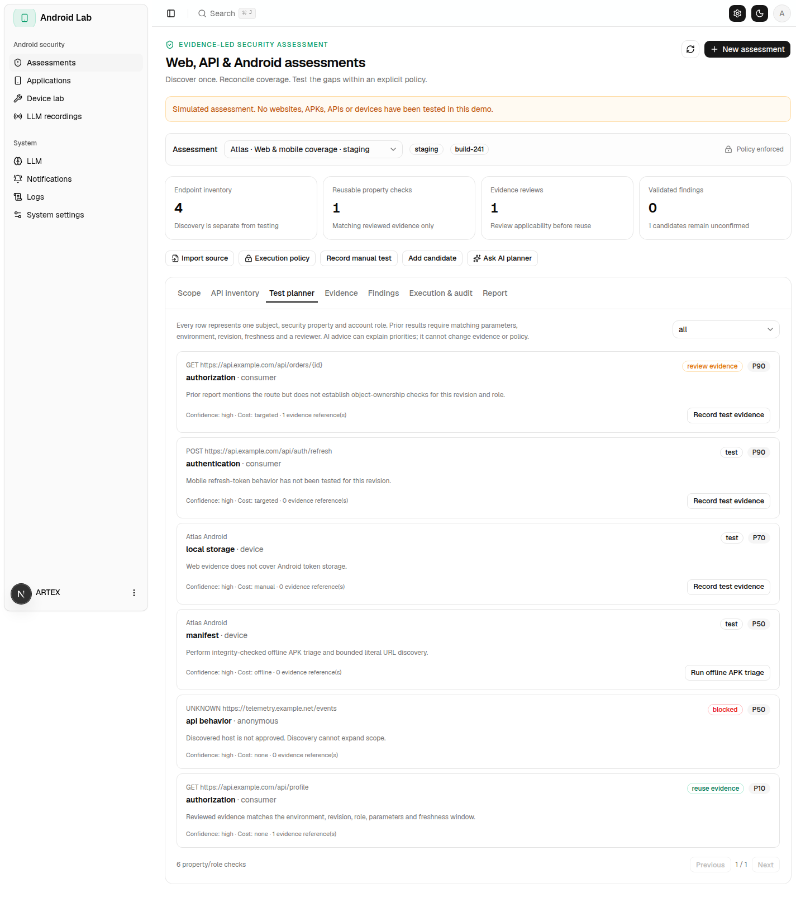

# Ripple

Ripple is an Android application security testing platform. Upload an APK, point Ripple at a test device and Burp Suite, and its agents analyze the app, drive it on the device, capture and replay its traffic, and record evidence-backed findings in a consolidated report.

It is built on the [ARTEX](https://github.com/mhtsec/ARTEX) agent framework: a Go backend with an embedded Next.js interface, PostgreSQL storage, and LLM agents (planner, workers, reporter, retester) coordinated around shared task records.



## Features

- **APK analysis** — upload APKs up to 256 MiB; inspect the binary or text manifest, permissions, exported components, SDK/version metadata and archive contents. Artifacts and triage reports are stored by SHA-256.
- **Burp-first dynamic testing** — APK tasks treat Burp Suite proxy traffic as the primary data source. Agents read proxy history and replay requests through the [Burp Suite MCP server](https://portswigger.net/bappstore), with static analysis as a secondary input.
- **Device control without root** — agents check the device, launch the app and drive its UI (dump, tap, swipe, type, key) over adb. This works on an unrooted Genymotion Android 11 image; Frida instrumentation is used when root is available.
- **Agentic and deterministic workers** — an LLM planner dispatches workers for runtime observation, SSL-pinning and root-detection checks, app-derived API checks and dependency CVE matching (SCA against OSV.dev), alongside a deterministic assessment pipeline.
- **Intelligent API security engine** — deterministic, identity-aware API tests the agents drive from captured traffic: endpoint discovery and normalization, an object/dependency graph, IDOR/BOLA differential testing, JWT/authentication checks, financial business logic (amount/limit/currency/idempotency), race/TOCTOU, workflow state machines, mass assignment and SSTI/SQLi injection. Verdicts are decided by response evidence rather than status codes, and confirmed findings auto-file with full reproduction and remediation. See [Intelligent API security testing](#intelligent-api-security-testing).
- **Evidence-backed findings** — findings link to stored request/response snapshots and other evidence; near-duplicate reports about the same artifact are merged instead of piling up. Findings can be retested in an independent session.
- **Controlled assessments** — define scope, environment, test accounts (encrypted with AES-GCM) and business rules; import OpenAPI, HAR, prior coverage, ZAP and MobSF results; reconcile coverage and generate a Markdown report.
- **Guard rails** — every agent tool call passes interception rules that can allow, block or escalate it for human approval; target-asset blocklists and per-task allow/block rules bound the scope.
- **Agent skills** — bundled skills include the [DragonJAR Android pentesting methodology](https://github.com/DragonJAR/Android-Pentesting-Skill), Android security review, API reconnaissance, browser automation and ScopeSentry asset management.

## Requirements

- Go 1.26.3+, Node.js 22 and npm
- Docker (for the bundled PostgreSQL container) or your own PostgreSQL 16 database
- Python 3 (session launcher)
- `adb`, plus a test device or emulator — Genymotion Android 11 is the tested target
- Burp Suite with the MCP server extension, and its CA certificate installed on the device
- An LLM provider (Anthropic, OpenAI-compatible, OpenAI Responses or Google Gemini) for agent planning

## Quick start

```bash
cd Android
cp config.example.json config.json   # set your database credentials
./build-android.sh                     # builds the web UI and the `androidlab` binary
./start.sh                             # starts PostgreSQL, adb and the server
```

Open http://localhost:8797. On first start, create the administrator password; the username is `Ripple`. Then:

1. **System → LLM** — add and activate a model profile.
2. **System settings → Burp Suite MCP** — confirm the MCP endpoint (default `http://127.0.0.1:9876`) and test the connection.
3. **Features → Device lab** — confirm your device is online and the toolchain (adb, apktool, jadx, frida) is detected.

`./start.sh` runs in the foreground; Ctrl-C, closing the terminal or stopping the launcher ends the session, and the launcher stops the `android-lab-pg` database container after the backend has saved interrupted work. For hot reload, `./start.sh --dev` serves the interface on port 3001 with the backend on 8797.

### Run with Docker

```bash
cd Android
cp .env.example .env    # set a unique URL-safe POSTGRES_PASSWORD
./start.sh --compose --build
```

Compose builds `android-lab:local` from this source. Back up the database, `data/` and the identity volume together.

## Testing an APK

1. Set up the device: start Genymotion, install the Burp CA certificate on it, and point its Wi-Fi proxy at Burp.
2. Upload the APK under **Features → Applications**.
3. Open **Features → Tasks & Assessments** and click **New APK Task**. Choose the APK, optionally pick a task template, and describe the objective.
4. Watch the task: agents check capture status, launch and exercise the app while Burp records its traffic, analyze and replay requests, and record findings as they go. Use the app yourself during observation windows for flows such as login.
5. Review findings under **Features → Findings**: each links to its evidence; confirm, mark as false positive, retest, or export.

For the controlled assessment workflow (scope, imports, coverage reconciliation, manual evidence, reporting) see [the assessment workflow](docs/ASSESSMENT_WORKFLOW.md) and [controlled assessments](docs/CONTROLLED_ASSESSMENTS.md). Test only applications and back ends you are authorized to test.

An HTTP 200 response is not an authorization pass, a scanner returning no alerts is not evidence of security, and a certificate-interception failure is a limitation, not proof that TLS is secure or broken.

## Intelligent API security testing

A deterministic, identity-aware API testing engine runs inside the normal APK task (goals → planner → worker), driven from Burp-captured traffic. The LLM proposes and sequences tests; fixed rules decide each verdict from the server's own responses, so a 2xx is never a finding on its own and false positives are controlled. Confirmed verdicts auto-file into the existing findings pipeline with full evidence — preconditions, reproduction steps, expected vs. actual, impact and remediation.

These are the `mobile_*` worker tools (see [APK penetration testing](docs/APK_PENTEST.md) for the full reference and sequencing):

| Area | Tools (`mobile_…`) | What they confirm |
| --- | --- | --- |
| Discovery & modeling | `api_harvest`, `api_graph`, `api_model`, `openapi_ingest` | normalized endpoint inventory; object + producer→consumer dependency graph; inferred parameter/response **types**, API **version** and discovery **confidence**; documented (inferred) endpoints from an OpenAPI/Swagger spec |
| Authorization | `identity_set` (with ownership map), `authz_diff`, `authz_sweep` (role×function matrix), `authz_expect` | IDOR/BOLA by differential (owner vs. another identity vs. unauthenticated), confirmed by data disclosure, not status; configurable shared-resource/role exceptions |
| Authentication | `jwt_probe`, `ratelimit_probe`, `session_probe` | JWT `alg:none` / tampered-signature / `exp` weaknesses; missing brute-force/rate-limit throttling; sessions not invalidated after logout |
| Financial logic | `txn_probe`, `race_probe`, `workflow_set` / `workflow_check`, `balance_check` | amount sign/limit, currency and idempotency invariants; race/TOCTOU (double-spend); out-of-order/skipped workflow steps; out-of-band ledger consistency (debit-matches, failed-txn-no-effect) |
| Input & injection | `schema_fuzz`, `mass_assignment`, `inject_probe` | 5xx on malformed input; privilege-field mass assignment (applied in the response); SSTI (evaluated expression) and error-based SQLi — on **JSON and form-urlencoded** bodies |
| Misconfig & exposure | `misconfig_probe`, `graphql_probe`, `data_exposure` | permissive CORS (reflected/credentialed Origin) + missing security headers; GraphQL introspection enabled; sensitive data (secrets, Luhn-valid PANs, SSNs, JWTs, keys) in responses |
| Coverage | `coverage` | which checks have run on each endpoint, and which endpoints remain untested |

Detection quality is measured against seeded ground-truth targets and an OWASP crAPI-modelled suite — precision, recall and false-positive rate per category — and a live crAPI integration harness runs the same deciders against a running instance (`go test ./internal/agent/ -run Eval -v`). The engine reuses the existing identity store, Burp replay and findings pipeline; it adds no new runtime dependencies.

## Configuration

| Setting | Purpose |
| --- | --- |
| `config.json` | Database connection and optional settings; see `config.example.json` |
| `ANDROIDLAB_CONFIG` | Path to an alternative config file |
| `ANDROIDLAB_PG_DSN` | PostgreSQL connection string (overrides `config.json`) |
| `ANDROIDLAB_SKILL_DIR` | Skills directory (default `skills/` next to the binary) |
| `ANDROIDLAB_LLM_*` | Default LLM provider, model, base URL and proxy |
| `ANDROIDLAB_ADB_DEVICES` | Comma-separated TCP device addresses to connect, e.g. `127.0.0.1:6555` |
| `ANDROIDLAB_SESSION_CONTAINERS` | Docker containers whose lifecycle the launcher owns (replaces automatic database selection) |
| `ANDROIDLAB_ENABLE_LEGACY_AGENTS` | Shell-capable legacy agents; `start.sh` sets `1`, use `ANDROIDLAB_ENABLE_LEGACY_AGENTS=0 ./start.sh` to disable |

Provider keys use their usual names (`ANTHROPIC_API_KEY`, `OPENAI_API_KEY`, `GEMINI_API_KEY`). Host scripts do not source `.env`; Compose does. JWT signing keys live in `identity/`, outside the browsable workspace.

The launcher runs a private adb server on a temporary loopback port and connects existing TCP devices such as Genymotion at `127.0.0.1:6555`. It does not take over the shared adb server, USB devices claimed by other tools, or externally started Genymotion, Burp or VPN services.

**Google Gemini**: create a profile with format *Google Gemini* and an available model ID (or use *Load available models*); leave the base URL blank for `https://generativelanguage.googleapis.com/v1beta`. Streaming and non-streaming modes support text, tool calls, thought summaries and token usage. Thinking uses budgets on Gemini 2.5 and levels on Gemini 3/4. The adapter targets the Gemini Developer `generateContent` REST API; Vertex OAuth, multimodal parts and built-in Google tools are not implemented.


## Command-line tools

```bash
go run ./cmd/apktriage app.apk > report.json     # offline manifest/archive triage; no database or LLM
go run ./cmd/apkassess -apk app.apk -device 127.0.0.1:6555 -out reports/run1
```

`apktriage` inspects the manifest and archive inventory; it does not decompile DEX, resolve resources, verify signatures or confirm runtime behavior. `apkassess` runs one autonomous assessment end to end — preflight, static decompilation, device checks and a Markdown/HTML/PDF report — with flags for the Burp proxy port and CA (`-proxy-port`, `-ca`), Frida server, observation time and budget.

## Project layout

```
cmd/            executables: artex (server, built as androidlab), apkassess, apktriage
internal/       Go application packages: server, agent, db, assessment, devicelab, androidapk, ...
third_party/    vendored norma agent SDK
web/            Next.js interface, embedded into the server binary
skills/         agent skills loaded at runtime
scripts/        session launcher and setup/smoke scripts
vapt/           Python VAPT helpers
validation/     Python validation harness and evidence pack
docs/           documentation
data/, reports/ runtime state and assessment output (git-ignored)
```

[The codebase guide](docs/CODEBASE.md) explains every package, the task lifecycle, the agent roles and where to change each feature.

## Development

```bash
go build ./... && go vet ./...
cd web && npx tsc --noEmit && npx biome lint . && npm test
```

Database tests connect through the normal configuration, so run them against a throwaway database by setting `ANDROIDLAB_PG_DSN` (see the [codebase guide](docs/CODEBASE.md#verify-a-change)) — otherwise they write test rows into your working database. Launcher regression tests: `python3 -m unittest discover -s scripts -p test_session.py -v`.

`NEXT_PUBLIC_MOCK=1 npm run dev` in `web/` runs the interface on clearly labeled simulated data, without a backend.

## Documentation

| Topic | Document |
| --- | --- |
| Setup details and dependencies | [docs/SETUP.md](docs/SETUP.md) |
| Codebase and architecture | [docs/CODEBASE.md](docs/CODEBASE.md) |
| Android task flow | [docs/ANDROID_TASK_FLOW.md](docs/ANDROID_TASK_FLOW.md) |
| APK penetration testing | [docs/APK_PENTEST.md](docs/APK_PENTEST.md) |
| Autonomous engine | [docs/AUTONOMOUS_ENGINE.md](docs/AUTONOMOUS_ENGINE.md) |
| Mobile checklist | [docs/MOBILE_CHECKLIST.md](docs/MOBILE_CHECKLIST.md) |
| Finding traffic evidence | [docs/FINDING_TRAFFIC_EVIDENCE.md](docs/FINDING_TRAFFIC_EVIDENCE.md) |
| Verification results | [docs/ANDROID_VERIFICATION.md](docs/ANDROID_VERIFICATION.md) |
| Research roadmap | [docs/research-roadmap/README.md](docs/research-roadmap/README.md) |
| Release history (inherited from ARTEX) | [CHANGELOG.md](CHANGELOG.md) |

## Attribution and license

Ripple is derived from [ARTEX](https://github.com/mhtsec/ARTEX), which is licensed under the GNU Affero General Public License v3.0 (AGPL-3.0). Preserve the upstream attribution and license terms when distributing this software.

Use Ripple only against applications, devices and services you are authorized to test.
