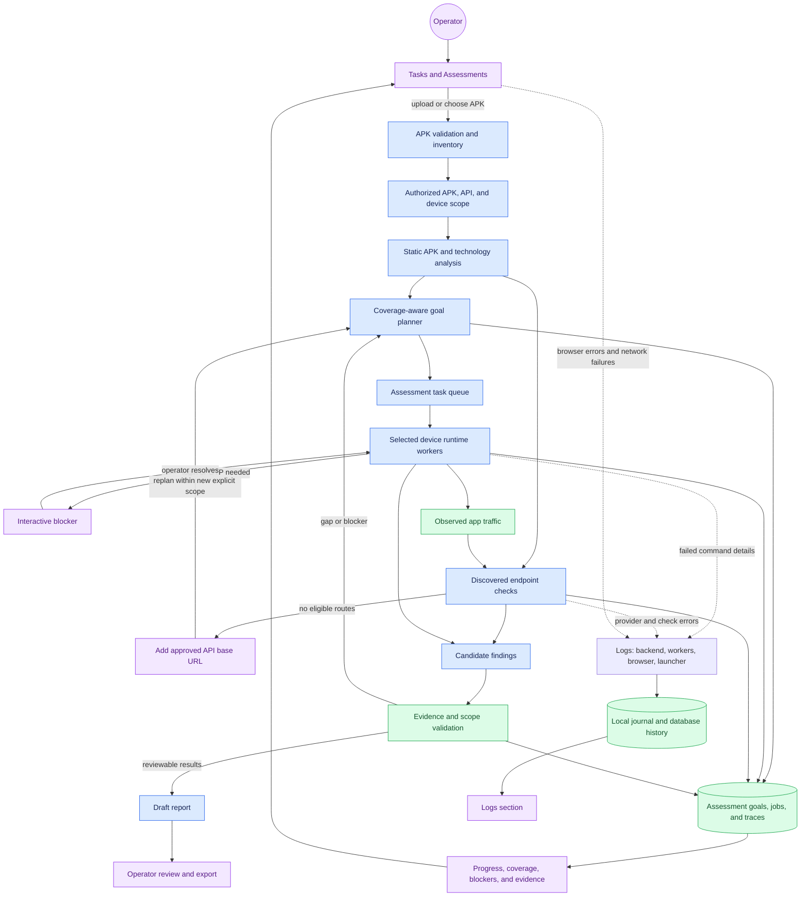

# Android task flow

Create an APK assessment from **Tasks & Assessments → Assessments → New APK Assessment**. Use **Upload APK** in the creation dialog (up to 256 MiB), or select an APK already in your library. A successful upload is selected automatically and fills the assessment name when blank. Optionally describe what to investigate and enter approved API base URLs. There is no field-specific character limit or truncation on the investigation objective; the field shows the number of characters entered. Existing overall request/document sizes and model context limits still apply. In Android runtime, select the online device and observation window, select the protection workers, then choose **Run Assessment**.

The assessment workflow and its Logs feedback path are:



The diagram uses Mermaid's `flowchart TD` syntax. Scope validation happens before evidence is stored; an out-of-scope evidence submission is rejected and logged as an HTTP 400, so it cannot become assessment evidence. Logs preserve the rejection reason and request ID for review.

The default lifecycle is:

1. **Goals and planning.** The investigation objective, approved APK/scope, restrictions, existing goals, facts and blockers go to a structured planning completion using the active global LLM profile. No credential values or raw responses are included. The model can describe and prioritize only existing worker types. Invalid output, provider rejection or an unavailable model falls back to deterministic planning. Existing completion criteria remain authoritative.
2. **APK workers.** Static inspection and Flutter artifact inspection establish build identity and collect source-backed observations.
3. **Protection workers.** Selected root/emulator and SSL workers install and hash-verify the exact uploaded artifact, then use Frida spawn-time hooks for the selected package on the selected device. Root work precedes TLS work; TLS work can carry the selected root hooks.
4. **Runtime worker.** Reapplies selected protection hooks for a fresh observation window, collects bounded request metadata, checks and PID-filtered logs. Manually exercise login and other app workflows during each window.
5. **API worker.** Once runtime completes, discovers app endpoints and runs the existing bounded API checks on eligible targets. APK strings and Flutter snapshot references are inventory only. If no target is eligible, the job is blocked, Logs shows skip-reason counts and the next step, and you can add an approved API base URL in the assessment's **Scope** tab. Adding a URL authorizes only its host and path prefix; it does not authorize other discovered references. Existing discovery exclusions, target policy, request budgets and role rules still apply. There is no automatic finding validation.
6. **Replan and review.** New evidence wakes the planning stage. Work is persisted as intents, executions, sources, facts and traces. The Engine tab displays goals, dependencies, planner mode, results and bounded retry controls.
7. **Report.** The report worker produces the existing evidence-backed draft. Review findings and limitations before final export. An unfinished goal, bypass attempt or absent hook event is never a security pass.

## Protection evidence

The built-in Java adapters cover RootBeer checks, known Flutter jailbreak/device-info plugin interfaces (including known obfuscated aliases), Conscrypt `TrustManagerImpl.verifyChain`, and supported OkHttp `CertificatePinner` methods. Optional classes are allowed to be absent. Unsupported native/obfuscated checks, Dart/Flutter pinning, anti-Frida and hardware attestation remain limitations; there is no universal native patch or guessed offset.

A root observation records when an actual positive detection result was overridden and the verified process remained alive. This demonstrates the override, not completion of login or all app workflows. TLS evidence additionally requires a connection operation returning after a rejected certificate/pin check was overridden on the same thread. Hook initialization alone proves neither. Encountered protections without post-override evidence create blockers. Protection blockers cannot be dismissed through a text-only resolution; retry the worker after correcting instrumentation or exercising the app.

Hooks detach when each bounded window ends. Later runtime jobs reapply the selected options. The runner does not change the device root setting, system trust store, proxy configuration or APK bytes. Frida and the selected device must already be available. Closing/cancelling a job terminates its owned instrumentation command; external ADB servers, emulator processes and other tools are not killed.

## Controls and compatibility

- Disabling a worker prevents its pending jobs from executing. Changing device or selected APK retires obsolete pending device work. Revoking instrumentation permission, pausing or cancelling stops queued/running jobs through the existing monitor.
- **Retry worker** respects the existing retry budget and retains the attempt count. A retry gets a new runtime job ID; interrupted work is never blindly replayed.
- Arbitrary free-text restrictions still need operator review. The built-in `No destructive operations. No out-of-scope testing.` restriction is enforced by the fixed dispatcher and does not block every runtime job.
- `POST /api/android/assessments/{aid}/run-assessment` defaults to the agent lifecycle. Its response contains `assessment`, `engine` and `message`; `root_bypass` and `ssl_bypass` select the workers. `workflow=direct` retains the older `dynamic_job` response and direct dynamic-to-API continuation for explicit compatibility callers.
- The parent ARTEX checkout and Android's opt-in legacy shell/MCP agents are separate. This lifecycle uses typed worker adapters, not arbitrary model-generated scripts or unrestricted MCP execution.

## Verification

```bash
go test ./internal/assessment ./internal/androidruntime ./internal/androidapk ./internal/mobiletest -count=1
node androidruntime/protections.test.cjs
go test ./internal/server -run 'TestEngine|TestRuntime|TestAndroidGoal|TestBypassEvidence|TestAssessment(Credential|Legacy|APK)' -count=1
(cd web && npm run typecheck)
```

`TestDynamicWorkflowPostgres` covers both the explicit direct compatibility workflow and the default agent entry point. Run it with `ANDROIDLAB_TEST_PG_DSN` pointing to a disposable database, or use `scripts/test-postgres.sh`. A real device/proxy run is still required to establish that a particular application's protection and workflow are supported. Adapter tests use simulated device and Java APIs; they are not live bypass evidence.
