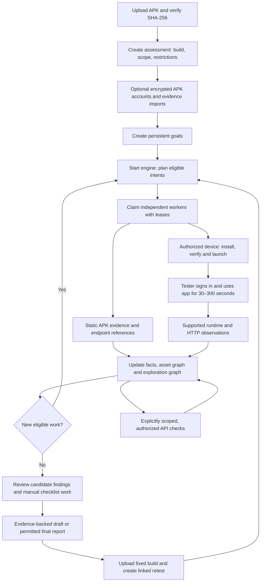

# APK assessment workflow

The previous flow was chiefly APK triage → device observation → a predefined API scan → manual review/report. The new optional engine persists goals and schedules eligible work as evidence arrives. Existing manual and runtime controls are retained.

1. **Upload the APK.** The upload pipeline computes its SHA-256 and extracts supported manifest/build information. A different hash identifies a different build even when the package matches.
2. **Create an assessment.** Select the uploaded APK and record environment, revision, scope, restrictions and workflows. Add literal approved API targets if active network testing is intended. APK strings never extend that scope.
3. **Optionally add accounts.** In **Android runtime → APK accounts**, select the APK, account role, username and password. Values are encrypted and are not sent to the planner or shown in graphs/reports. Saved accounts do not perform login; sign in manually on the selected device.
4. **Import existing evidence.** Existing OpenAPI, HAR, MobSF, ZAP and supported historical imports feed the same assessment inventory/evidence records. Imported indicators remain candidates or observations until reviewed.
5. **Configure execution policy.** Authorize the exact online ADB device for runtime work. Enable active API testing only for explicitly scoped targets. Observation duration remains 30–300 seconds. Missing authorization leaves work blocked.
6. **Start the assessment engine.** The execution tab shows goals, prerequisites, intent state, retries, worker traces, and asset/exploration relationships. Baseline APK analysis verifies the stored hash again before using it. Independent local work can run concurrently; device/API jobs retain their existing reservations.
7. **Use the application manually.** Runtime work installs/verifies/launches the approved APK and collects supported application-scoped observations. Authenticate and exercise approved business workflows during the observation window. Missing Frida/device capability is recorded as a limitation.
8. **Follow evidence-driven replanning.** Relevant committed changes coalesce into a planner wakeup. Observed endpoints can make supported API work eligible, but static discovery alone proves neither reachability nor authentication. State-changing actions, destructive tests and multi-account authorization exploitation are not generated automatically.
9. **Review the checklist and findings.** All 91 procedures across 13 sections remain. Observed, blocked, inconclusive and reviewed outcomes stay distinct. Not-applicable procedure decisions require reviewed evidence and rationale. A candidate needs applicable reviewed evidence before validation; contradictory observations remain available.
10. **Export a report.** The existing Markdown report includes build identity, scope, API inventory, checklist, findings, evidence and limitations, plus goal state. A generated draft does not mean every assessment goal is complete. Existing final-report gates remain.
11. **Retest a fixed build.** Upload the replacement APK and create a linked retest from the execution view. New evidence is independent. Compare reviewed outcomes; no new finding is not evidence that an old vulnerability was fixed.

Manual work remains necessary for login, meaningful application use, business-logic testing, authorization-policy and multi-account comparisons, unsupported instrumentation, many platform/storage procedures, candidate validation and remediation review. This is an evidence-driven assisted assessment system, not automation of every checklist procedure.
