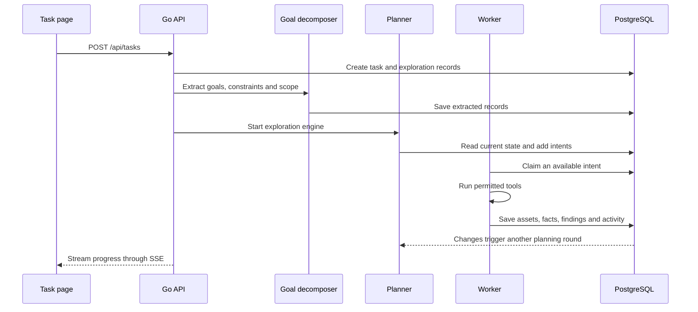

# Ripple codebase guide

Ripple is an Android application security testing platform built on the ARTEX agent framework. A Go backend coordinates LLM agents and deterministic workers around shared task records; the interface is a Next.js/React application embedded into the same binary. PostgreSQL stores tasks, assets, findings, assessments, agent configuration and activity. The vendored `norma` module supplies the agent loop, tools, model adapters, permissions and transcripts.

## Repository layout

```
Android/
├── cmd/                    Executables
│   ├── artex/              Main server (built as `androidlab`): API, engine, embedded web UI
│   ├── apkassess/          Non-interactive end-to-end APK assessment (preflight → static → device → report)
│   └── apktriage/          Offline APK inspector; needs neither PostgreSQL nor an LLM
├── internal/               Application packages (Go `internal/`: not importable outside this module)
│   ├── server/             HTTP API, auth, task manager, scheduling engine, conversations, approvals
│   ├── agent/              Agent prompts, runtime assembly, domain tools, mobile/Burp tools, wrap-up
│   ├── db/                 PostgreSQL schema (`schema.sql`), queries, transactions, graph records
│   ├── assessment/         Controlled assessment engine: planning graph, MASVS checklist, reports, retests
│   ├── androidapk/         Bounded offline APK inspection (manifest, permissions, components, archive)
│   ├── staticx/            Static extraction: manifest, native libraries, resources, sources
│   ├── androidruntime/     Runtime observation and protection checks on an ADB device (Frida scripts)
│   ├── devicelab/          Device control over adb, Burp MCP client, Frida sessions, bypass library,
│   │                       UI explorer, IDOR/injection checks, proxy and egress handling
│   ├── devicelease/        Device ownership coordination across host processes
│   ├── apicheck/           Predefined, bounded checks on endpoints derived from the app
│   ├── mobiletest/         Mobile test catalog (`catalog.json`)
│   ├── sca/                Offline dependency enumeration matched against OSV.dev advisories
│   ├── sectool/            Built-in security tool registry
│   ├── traffic/            MITM recording proxy and HTTP traffic storage/search
│   ├── evidence/           Saved evidence snapshots used by findings
│   ├── intercept/          Tool-call interception rules, model review, approvals
│   ├── guard/              Scope checks
│   ├── llmpool/            Provider selection, health, cooldowns and failover
│   ├── llmrec/             Recording of model requests, responses, usage and errors
│   ├── mcphttp/            Remote MCP HTTP/SSE client support
│   ├── enrich/             Asynchronous asset enrichment
│   ├── notify/             Finding notification rendering and delivery channels
│   ├── report/             Markdown and CSV export rendering
│   ├── sidequestion/       Independent `/btw` questions using captured context
│   ├── selfupdate/         Release download, verification, swap and rollback
│   └── config/             JSON configuration and environment overrides
├── third_party/norma/      Vendored norma agent SDK (separate Go module, wired with `replace` in go.mod)
├── web/                    Next.js interface (static export embedded into the server binary)
├── skills/                 Agent skills loaded at runtime, one per subdirectory (`SKILL.md` + files)
├── scripts/                Session launcher (`session.py`), setup and smoke-test scripts
├── vapt/                   Python VAPT helper package
├── validation/             Python validation harness and evidence pack
├── docs/                   Documentation (this guide, workflows, verification, research notes)
├── examples/               Import templates (OpenAPI, coverage report)
├── testdata/               Shared test fixtures
├── data/                   Runtime state: task workspaces, uploads, logs (git-ignored)
└── reports/                Assessment outputs and engagement deliverables (git-ignored)
```

`data/` sits inside the module directory, and agents write arbitrary files — including `.go` scripts — into task workspaces under it. The server drops a `go.mod` into the data directory at startup so it becomes a separate module and `go build ./...`, `go vet ./...` and `go test ./...` never try to compile agent scratch files.

## A useful reading order

1. [cmd/artex/main.go](../cmd/artex/main.go): how the executable starts, loads configuration, builds the server and shuts down.
2. [internal/config/config.go](../internal/config/config.go): configuration paths, database settings and the skills directory.
3. [internal/server/manager.go](../internal/server/manager.go): the `Task` structure and ownership of task/store lifecycles.
4. [internal/server/server.go](../internal/server/server.go): server initialization and the HTTP route table in `Handler`.
5. [internal/server/engine.go](../internal/server/engine.go): scheduling the planner and workers for a task.
6. [internal/agent/planner.go](../internal/agent/planner.go) and [internal/agent/worker.go](../internal/agent/worker.go): instructions and runtime options for those roles.
7. [internal/db/exploration.go](../internal/db/exploration.go), [internal/db/assets.go](../internal/db/assets.go) and [internal/db/schema.sql](../internal/db/schema.sql): the persistent records the agents read and write.
8. [internal/server/task_apk.go](../internal/server/task_apk.go) and [internal/agent/mobiletools.go](../internal/agent/mobiletools.go): how an APK task is briefed and which mobile tools its agents get.
9. [web/src/lib/api.ts](../web/src/lib/api.ts) and [web/src/app/(main)/function/tasks/page.tsx](../web/src/app/%28main%29/function/tasks/page.tsx): how the interface creates tasks and displays results.

You do not need to understand every tool or model adapter before following a task through these files.

## The main data structures

A **Task** is one engagement with a description, a desired outcome, a scope, execution settings and an exploration store. Its `ID` is the task ID; its `ExpID` identifies its exploration graph. The IDs are related but not interchangeable.

An **asset** is a domain, subdomain, IP address, service, application or endpoint. Assets are shared globally and may be associated with several tasks. A company groups assets using scope rules. An uploaded APK is stored under `data/android/apps/<sha256>/` and referenced by its hash.

An **exploration node** records something about a task's progress:

| Node kind | Meaning |
| --- | --- |
| `goal` | A final outcome that must be verified |
| `intent` | A concrete direction assigned to a worker |
| `fact` | An observation returned by execution |
| `finding` | A vulnerability discovered during exploration |
| `hint` | Guidance supplied to the planner or agents |

Graph edges record how nodes relate, and asset anchors connect a node to the assets it concerns. See [internal/db/exploration.go](../internal/db/exploration.go) and [internal/db/exploration_sources.go](../internal/db/exploration_sources.go).

A finding has both an **exploration node ID** and an **independent finding record ID**. Some report APIs use the node ID; traffic-evidence APIs use the finding record ID. Read each tool's schema before passing an ID. All findings are recorded through one chokepoint, `RecordFindingTx` in [internal/db/finding_traffic.go](../internal/db/finding_traffic.go); agent-reported findings opt into de-duplication there, so a near-identical report about the same artifact merges into the existing finding (raising its severity if needed) instead of creating a duplicate.

## What happens when you create a task



Task concurrency limits or unavailable LLM profiles can queue a task before execution. The engine handles pausing, resuming, intent ownership, and draining running work at shutdown or timeout; see [internal/server/task_control.go](../internal/server/task_control.go), [internal/server/task_llm.go](../internal/server/task_llm.go) and [internal/server/engine_timeout.go](../internal/server/engine_timeout.go).

## Android testing

An APK task ("New APK Task" in the interface) carries a brief built in [internal/server/task_apk.go](../internal/server/task_apk.go) that makes **Burp Suite traffic the primary data source**: agents check the device and capture status, read proxy history through the Burp MCP server, drive the app to generate traffic, then replay requests. Static analysis is secondary.

Mobile tools for agents are defined in [internal/agent/mobiletools.go](../internal/agent/mobiletools.go) and [internal/agent/mobileui_tools.go](../internal/agent/mobileui_tools.go):

| Tool | Purpose |
| --- | --- |
| `mobile_capture_status`, `mobile_traffic_history`, `mobile_traffic_replay` | Burp MCP status, proxy history and replay |
| `mobile_device_status`, `mobile_launch_app` | Device health and launching the app under test |
| `mobile_ui_dump`, `mobile_ui_tap`, `mobile_ui_swipe`, `mobile_ui_type`, `mobile_ui_key` | Driving the app UI over adb without root |

Device control is plain adb ([internal/devicelab/device.go](../internal/devicelab/device.go)); it works on an unrooted Genymotion Android 11 image, whose `adb shell` already runs as uid 0. Frida-based instrumentation needs root. The deterministic assessment pipeline lives in [internal/assessment](../internal/assessment) and is described in [the task flow guide](ANDROID_TASK_FLOW.md) and [the APK pentest guide](APK_PENTEST.md).

## Agent roles

| Agent key | Role |
| --- | --- |
| `goals` | Extract final outcomes, explicit constraints and minimal test scope |
| `planner` | Assess the current graph, maintain the plan and create exploration intents |
| `worker` | Execute one intent and save results |
| `mainagent` | Handle user messages for a task and guide ongoing work |
| `auto` | Operate the platform using task and configuration tools |
| `pentest` | Standalone conversational agent that plans, executes and verifies its own work |
| `reporter` | Write a detailed report for a newly registered finding |
| `retester` | Recheck one finding in an independent conversation |

Built-in agent metadata is seeded in [internal/db/db.go](../internal/db/db.go). Editable prompt bodies are cataloged in [internal/agent/promptcatalog.go](../internal/agent/promptcatalog.go), with role-specific defaults in the role files. Prompt versions are stored in PostgreSQL; `PromptOverride` in [internal/agent/prompt.go](../internal/agent/prompt.go) reads the configured body at runtime. English output guidance is appended to agent system prompts in [internal/agent/deferred.go](../internal/agent/deferred.go) and to goal decomposition in [internal/agent/goals.go](../internal/agent/goals.go).

## How tools and skills reach an agent

[internal/agent/toolcatalog.go](../internal/agent/toolcatalog.go) defines the built-in tool catalog. [internal/agent/tools.go](../internal/agent/tools.go) and related files implement graph and task tools. [internal/server/orchestration.go](../internal/server/orchestration.go) exposes platform/task operations, and [internal/server/customtool.go](../internal/server/customtool.go) runs custom shell, command, Python or HTTP tools.

[internal/server/assembly.go](../internal/server/assembly.go) combines tools, configured bindings, skill visibility and MCP servers for each agent, and [internal/agent/assembly.go](../internal/agent/assembly.go) applies that assembly to a run. Deferred tools are advertised by name and disclosed later; MCP tools listed in a skill's `mcps:` frontmatter are unlocked when that skill is loaded.

`skills/` holds instructions, not Go packages: each skill has a `SKILL.md` with YAML frontmatter (`name`, `description`, optional `mcps`) plus optional references and scripts. The directory is set with `skill_dir` in `config.json` or `ANDROIDLAB_SKILL_DIR`. Bundled skills: `android-pentesting-skill` (DragonJAR methodology), `android-security`, `api-recon`, `playwright-cli` and `scopesentry`.

Every tool call passes through the interception rules in [internal/intercept](../internal/intercept), which can allow, block or escalate a call for human approval; the built-in rules are seeded in [internal/db/db.go](../internal/db/db.go).

## Following a frontend request

A page component calls a method on `api` from [web/src/lib/api.ts](../web/src/lib/api.ts). The client sends an HTTP request to `/api/...`; in development [web/next.config.mjs](../web/next.config.mjs) proxies it to the Go backend on port 8797. The server's `Handler` dispatches to the right method, which reads/writes database records and returns JSON. Shared response types live in [web/src/lib/types.ts](../web/src/lib/types.ts); backend DTO conversion lives in [internal/server/dto.go](../internal/server/dto.go).

Long-running agent progress arrives as activity over SSE. [web/src/components/transcript.tsx](../web/src/components/transcript.tsx) displays messages, tool calls, results, reasoning blocks and approvals; [web/src/lib/activity-merge.ts](../web/src/lib/activity-merge.ts) merges overlapping activity responses without duplicating steps.

`(auth)` and `(main)` are Next.js route groups; the parentheses do not appear in URLs. For example, `web/src/app/(main)/system/settings/page.tsx` serves `/system/settings`.

## Where to change a feature

| Change | Start with |
| --- | --- |
| Navigation labels and links | `web/src/navigation/sidebar/sidebar-items.ts` |
| Application title and description | `web/src/config/app-config.ts` |
| Theme tokens (radius, colors, shadows) | `web/src/app/globals.css` |
| Status/severity labels | `web/src/lib/status.ts` |
| Task creation form | `web/src/app/(main)/function/tasks/page.tsx` |
| New APK task form | `web/src/components/apk-task-dialog.tsx` |
| Applications / Device lab pages | `web/src/app/(main)/android/page.tsx`, `web/src/app/(main)/android/devices/page.tsx` |
| Task detail tabs | `web/src/app/(main)/function/tasks/detail/_tabs/` |
| Agent prompt/configuration editor | `web/src/components/agent-editor.tsx` |
| New API endpoint | Route registration in `internal/server/server.go`, then a focused handler file |
| A database operation | The relevant file in `internal/db/`, with schema changes in `internal/db/schema.sql` |
| APK task brief | `internal/server/task_apk.go` |
| Mobile and Burp tools | `internal/agent/mobiletools.go`, `internal/agent/mobileui_tools.go`, `internal/devicelab/` |
| Planner / worker behavior | `internal/agent/planner.go`, `internal/agent/worker.go` |
| Tool bindings and resource visibility | `internal/server/assembly.go`, `internal/agent/assembly.go` |
| Report exports | `internal/report/findings.go`, `internal/report/report.go` |
| Notification wording | `internal/notify/markdown.go`, `internal/notify/html.go`, channel adapters |
| Simulated demo records | `web/src/lib/mock/data.ts` and `handler.ts` |

`internal/db/schema.sql` runs on every startup and must stay idempotent (`IF NOT EXISTS`, `OR REPLACE`, guarded migrations).

Changing source does not alter an already compiled binary. Rebuild with `./build-android.sh`, or use `./start.sh --dev` for hot reload.

## Verify a change

```bash
go build ./... && go vet ./...
cd web && npx tsc --noEmit && npx biome lint . && npm test
```

**Database tests use the live database by default.** Tests in `internal/db` and several other packages connect through the normal configuration, so running them without an override writes test rows into your working `androidlab` database. Point them at a throwaway database first:

```bash
docker exec android-lab-pg psql -U androidlab -d androidlab -c 'CREATE DATABASE androidlab_test'
ANDROIDLAB_PG_DSN='postgres://androidlab:<password>@127.0.0.1:55434/androidlab_test?sslmode=disable' \
  go test -p 1 ./... -count=1
```

`-p 1` runs packages one at a time: several packages create schema and fixtures in the same database, and running them in parallel against one database causes spurious deadlocks and missing-table errors.

`NEXT_PUBLIC_MOCK=1 npm run dev` (in `web/`) runs the interface on simulated data, useful before a database or model provider is configured.

## Legacy compatibility data

Ripple's sources and documentation are in English. A few strings deliberately keep Chinese text, written as `\u` escapes in code, because they match data produced by older ARTEX versions or by targets: the `[Model]` approval-reason fingerprint (`internal/intercept`, `internal/db`, `schema.sql`), legacy chat-mention aliases (`internal/server/chat_mentions.go`, `web/src/lib/chat-mentions.ts`), legacy command prefixes and the old default conversation title, provider billing-error phrases used to detect quota exhaustion (`internal/agent/provider.go`), ICP-filing and full-width punctuation input handling, Unicode test fixtures, and the login-detection patterns used by the `api-recon` skill against Chinese-language targets. Changing these would break compatibility with existing data; see the [Go translation audit](GO_TRANSLATION_AUDIT.md).
