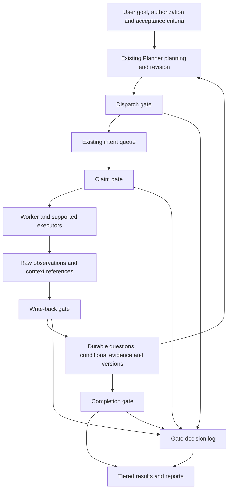

# ARTEX question-driven experiment search architecture

Created: 2026-10-15. Review update: 2026-10-16. Source baseline: a9d11cb. Status: R&D design; the new mechanisms are not implemented yet.

The current main plan keeps the existing Planner, Worker, dual graph and the Go and PostgreSQL core, establishes shared programmatic constraints at four points -- dispatch, claim, write-back and completion -- and persists questions, observations, evidence and versions. These mechanisms' actual improvement to exploration quality is validated first, before deciding whether to change the control loop.

A standalone search controller is demoted to a conditional alternative. Only if repeatable, attributable global scheduling problems still appear after the main plan is running, and simple rules cannot solve them effectively, does a standalone control prototype begin; adoption is decided by control results under the same budget.

## Architecture decisions after review

| Arrangement in the original plan | Decision after review | Reason |
| --- | --- | --- |
| A new controller at the center of the whole architecture | The four gates and durable records in the existing loop are the main deliverable | The value of explicit state does not yet prove that replacing the control loop is necessary |
| Questions, explanations and evidence gaps maintained exclusively by the new mode | Wired into the existing Planner first and reused across rounds and workers | This benefit can be obtained and validated independently |
| The dual frontier lands first with the new controller | Record the cost and waiting of exploration and proof first, and try stage quotas and simple priorities | Prove a resource imbalance exists before paying for a complex selector |
| The six routes as capability plug-ins of the new architecture | Each route plugs into the original scheduling; R05 sinks into a common checking capability | Avoids migrating whole tasks just to use one capability |
| Build the prototype first, then confirm the main source of benefit | Trace auditing comes first, and four evaluation groups isolate the sources of benefit | Gains from foundational fixes, structured records and the controller are counted separately |

This revision keeps conditional conclusions, real experiments and open exploration directions; what changes is the implementation order and the threshold for starting a controller. Stage deliverables and dependencies follow the [innovation roadmap and version plan](research-roadmap/README.md), and foundational fixes are detailed in [architecture review and evolution design](ARCHITECTURE_REVIEW_AND_EVOLUTION.md).

## Main architecture keeping the existing loop

The Planner keeps proposing and arranging directions; the program controls whether its submissions take effect, whether evidence can be reused, and whether evidence can be promoted to goal completion. The four gates are shared domain rules, not another control loop choosing the next piece of work.

### Responsibilities of the four gates

| Gate | Existing integration point | New mainline rules |
| --- | --- | --- |
| Dispatch gate | `add_intent` and the shared intent-creation operation | Check ownership, authorization, required evidence and its versions; machine-decidable prerequisites are checked by registered predicates, and evidence pending review cannot be treated as an established prerequisite |
| Claim gate | `claimNext` in `internal/server/engine.go`, `ClaimIntent` in `internal/db/exploration.go` | Re-check dependency versions and claimability at claim time; in-database checks stay consistent with the state change, and failures enter a waiting or review state with a reason |
| Write-back gate | `record_fact`, `report_finding` and shared storage operations | Store observation references and context, distinguish observations, explanations and assertion results; nodes, required relationships and state are committed atomically |
| Completion gate | `prove_goal`, `goal_met` and the final completion decision | Every automatic completion entry point uses the same acceptance rule; evidence sufficiency and applicability conditions are checked, and quantified goals use explicitly defined program metrics |

New task seeds, manual submissions and platform tools also have intent-creation paths. They should call the shared domain operations, stating the operation source and human decision explicitly; bypassing a particular tool function must never skip the common constraints.

The claim check makes prerequisite checks more timely but cannot eliminate the window in which the environment changes after a claim. Supported executors re-check actual conditions before key actions and, where needed, after results; without a reliable observation of external state it stays unknown. Database transactions never span network requests.

The Planner and Worker can still use general-purpose tools. The four gates cannot be described as complete interception of arbitrary Bash, third-party tools and all network requests; operations that need scope or per-request budget guarantees must go through an execution adapter with that capability.

### Predicate authority and open exploration

Machine predicates use registered names, versions, input types, trusted observation sources and result semantics. Only checks the program actually completed can affect admission, evidence validity and conclusion promotion within their applicable scope. HTTP status codes, unique markers or owner fields are only observation elements and cannot each prove a permission violation on their own.

Model annotations use an open vocabulary to explain, propose candidates, estimate relative value and suggest review. An `observed` value, role label or score filled in by the model is not a program endorsement. A proof can consist of several real observations plus implemented derivation rules; not every top-level conclusion needs to be labeled `observed`.

Review suggestions are separate from blocking states. The model can register suspected conflicts, but only a registered rule or an explicit human decision can change evidence validity; when a necessary condition lacks evidence, the program's unknown-handling rule decides whether to defer, and free-form model labels cannot control admission.

Unsupported assertions stay candidates or go to human review. What is closed is the set of automatic decision rules; open discovery still allows raising new questions, preparing prerequisites and running bounded exploration experiments. Modes are controlled per route and per predicate capability together; promoting a whole route cannot replace validating individual checkers.

### Observation details and plan evidence

A fact can keep serving as a concise summary; beneath it are stored separate observation details or stable detail references, including the actual identity, object, time, method, state and raw records. Observations under different conditions can be summarized together but cannot be merged into an unconditional truth.

The current `record_fact` tool instruction asks the model to summarize several observations; it is not an automatic database merge. To avoid losing information before structuring, supported executors save raw observations and context first, and the model writes the summary afterwards. The existing `confirmed` workflow state and the new assertion evaluation state are migrated separately; all historical nodes cannot simply be treated as independently validated.

Plan persistence needs to design evidence references, expected-output references and versions. Facts not produced yet are expressed with plan-output placeholder references and bound to actual observations or assertions once produced; whether a step is complete is derived from valid outputs, and ticking a todo cannot replace evidence. R01's semantic review is added incrementally on top of this.

The existing `TriggerEvent` and debounce are reused to wake the Planner; evidence invalidation and review todos must be persisted first and rescanned at startup and recovery. In-memory notifications reduce latency and are not the only record of changes.

### Common baselines and execution channels

Build baseline records isolated by target, subject, object, state and purpose, with unified source references, versions, re-check deadlines and invalidation rules. R02's owner controls, R03's normal flows and R05's session health share the infrastructure while each keeps a different oracle.

The first protocol-native channel is a structured HTTP executor supporting session injection, dynamic dependency extraction, control association and recording actual requests/responses, reusing the existing evidence facilities. Whether traffic passed through global capture and whether there is a reliable observation are judged separately; wiring in a route never turns on global capture automatically.

Bash and other tools remain general-purpose channels. Evidence eligibility is judged by source, completeness, context and verifiability; HTTP is not inherently sufficient, and command output with reliable execution records is not inherently inferior. Without a structured adapter, state explicitly which capabilities are missing.

### Concurrency and side effects

When new sessions or controlled objects can be created, prefer resource isolation to reduce mutual contamination. Permission differentials still need to compare the same object under test; non-copyable business state, shared backends and race-condition tests cannot be replaced with new objects.

Conflict records include the authentication domain or tenant, subject, object set, state domain and read/write effect. Conflicts are judged by comparing shared resources; even with different subjects, writes to the same object can conflict, so mutual exclusion cannot depend only on whether complete tuples are equal.

The executor states its known scope of effect, and unknown parts are handled conservatively. The model can narrow the authorized scope or ask for stronger isolation but cannot shrink the executor's known side-effect scope to bypass protection. Write actions already sent whose results are unknown are reconciled first, never replayed directly.

## Reporting and stop rules

Gate decision logs ship together with the new oracles, recording the actual allow, deny, defer or require-review decisions, along with input references, context versions, predicate versions, reasons and the associated task. Unevaluated candidates can never be described in logs as having been compared and rejected.

Reports show observations, rule sources, applicability conditions, evidence levels and what is missing. The existing evidence version and standalone retest UI are reused; the new experiments' four-valued results do not directly replace the retest's `reproduced/fixed/inconclusive`. `not_reproduced` in particular must come with the method, a valid control and conditions, and can never be displayed as overall safety.

The task objective first pursues evidence-backed goal output within budget, while constraining wrong completions, invalid experiments and resource cost. Exploration breadth, proof progress and necessary state preparation are measured separately; the dual frontier is only a means to avoid lopsidedness, and quotas are adjusted as task stages are validated.

The mainline adds bounded stop rules: when the budget is exhausted, a prerequisite block cannot be recovered, or within a pre-agreed observation window neither candidate review nor limited alternative strategies produce usable progress, partial results and the stop reason are recorded. Windows and cost thresholds are registered before evaluation. Long-term low-feedback routes may still have value and cannot be pruned only for producing no new facts in the short term.

Goal achieved, budget exhausted, blocked prerequisite, insufficient stage gain and manual stop are distinct termination reasons. Stopping exploration does not mean acceptance passed, let alone that the absence of vulnerabilities has been proven.

## Separating mainline benefit from controller increment

| Problem to improve | Mechanism the mainline provides first | What a new controller must additionally prove |
| --- | --- | --- |
| Invalid tests treated as valid results | Common validity checks, baselines and conditional results | Whether its global selection lowers recovery cost further |
| Execution continues after evidence is invalidated | Durable dependencies, version checks, review and the claim gate | Rescheduling gains beyond simple re-waking and queue rules |
| Tasks completed wrongly | Shared completion gate, evidence references and acceptors | Completion correctness itself does not count as a benefit of replacing the controller |
| Imbalance between discovery and proof | Cost ledger, stage quotas and Planner hints | Whether a standalone selector stably improves global budget allocation |
| Condition pollution across workers | Resource isolation, execution adapters and conflict checks | Whether effective throughput improves under the shared constraints |
| Decisions hard to explain | Gate logs, evidence and reports | Whether cross-question trade-offs become more verifiable and worth the extra overhead |

The value of these mechanisms is an expectation still to be tested. Improvements already gained from graph transactions, recovery, evidence and the four gates cannot be counted again as a controller increment.

## When is a new controller needed

### Necessary conditions for starting a standalone control prototype

Before entering A2, all of the following must hold:

1. Mainline M1 and M2 have passed acceptance for the task types under study; records can distinguish strategy, execution, evidence, gate-rule and state-recovery problems.
2. The same kind of scheduling failure reproduces in independent tasks or repeated reset runs, with complete candidates, budget, evidence versions, gate decisions and execution consequences kept; isolated cases are not enough to start a project.
3. At the time, valuable alternative candidates with satisfied prerequisites existed, and the failure came mainly from cross-round selection or global resource allocation, not from a lack of executable actions.
4. Smaller changes such as stage quotas, priorities, de-duplication and dependency wake-ups have been compared; problems remain, and the concrete benefit mechanism of replacing decision authority can be stated.
5. The task set, repetitions, main metric, allowed regression range and all cost caps are registered in advance, forming a verifiable control plan. Without registered thresholds, the automatic control prototype is not started.

What is required here is mainline validation for the target task types, not completion of all six routes. Offline analysis can proceed alongside the audit but must not become an extra dependency of mainline delivery.

### Residual problems that can justify starting a project

| Residual problem | Evidence needed | Causes to rule out first |
| --- | --- | --- |
| Persistent starvation of exploration or proof | Executable candidates wait long while the budget is consumed by the other kind of work, and simple stage quotas still do not help | Invalid candidates, lost notifications, unrecovered prerequisites |
| Cross-question dependencies repeatedly out of order | Durable evidence and events are correct, but the Planner keeps choosing ill-timed directions, breaking valid chains | Missing dependency schema, wrong claim checks, state lost in recovery |
| Global budget trade-offs persistently off target | Candidate quality is usable under the same budget, but cross-round selection keeps causing avoidable waste | Tool failures, the model proposing no usable candidates, gaps in budget accounting |

Data loss, `Link` swallowing errors, missing permission rules, mixed sessions, reports lacking evidence and one-off prompt mistakes are all fixed in the mainline first. More complex tasks, more nodes or a new controller sounding more innovative cannot by themselves trigger a project.

### Promotion conditions for adopting a new controller

A2 compares standalone decision authority only on controlled tasks. Relative to the complete mainline it must improve the pre-registered main output metric, or lower total cost while output and correctness meet preset requirements; the advantage must appear in repeated paired runs and on held-out tasks not used for tuning.

Wrong completions, false positives/negatives, undecidable cases, open discovery capability, short-task duration and total cost are checked at the same time. Gains that depend on more requests, a stronger model, extra rule input or a changed task definition are not credited to the controller. With insufficient samples, observation or suggestion mode is kept.

If these conditions are not met, the gated Planner continues to be used. Only after each supported task type passes validation separately is usage widened gradually; the default control loop of all tasks is never replaced directly.

## Design of the conditional alternative controller

### Decision unit and control authority

Only after admission are durable questions, possible explanations and evidence gaps made the main scheduling unit. The model proposes a few candidates, and a standalone selector handles cross-question selection and budget allocation on top of the existing four gates; observation, evidence, acceptance and reporting follow the mainline.

The candidate generator uses tool-free or restricted read-only calls and cannot dispatch, execute and declare completion all at once. Explanations can coexist and are not treated as mutually exclusive or exhaustive; unknown prerequisites generate validation tasks and cannot be written in as facts.

### Exploration and proof dual frontier

The exploration frontier looks for new entry points, object relationships and business structure, while the proof frontier fills in controls, prerequisites and effect evidence for existing directions. State preparation and diagnosis are charged to the object they serve and to the total cost; they cannot become an off-the-books third category of overhead.

Common admission conditions are checked first, then candidates are compared by goal relevance, eliminable uncertainty, follow-up actions and known cost. Model scores are heuristics only and are not interpreted as calibrated success probabilities. The first version compares within bounds, with no requirement for Monte Carlo tree search or an environment simulator.

The independent value of the dual frontier must be validated against the mainline's stage quotas, with proportions adjusted per task stage. No new facts only triggers a strategy review and does not prove every direction is invalid.

### Changes to original components and switching

| Location | Change in the conditional alternative |
| --- | --- |
| [internal/server/engine.go](../internal/server/engine.go) | Wire the standalone selector in for designated task types, keeping the lifecycle, budget and four gates |
| [internal/agent/planner.go](../internal/agent/planner.go) | Serves as the candidate generator or the original-mode planner, chosen by task mode |
| [internal/agent/tools.go](../internal/agent/tools.go) | Dispatch and completion keep calling the shared domain rules; the candidate generator holds no direct submit authority |
| [internal/agent/worker.go](../internal/agent/worker.go) | Keeps the mainline execution adapters, observation records and side-effect handling |
| [internal/db/exploration.go](../internal/db/exploration.go) and the evidence facilities | Reuse the same state, references and versions, avoiding a second source of facts |

The same Go process and PostgreSQL are kept; microservices, an extra graph database or a trained world model are not introduced by default. Each task has only one decision controller at any moment; a mode switch first stops new dispatches, wraps up in-flight work and reconciles unknown actions, then migrates the checkpoint.

A decision branch is not a physical copy of the target environment. Reset comparisons are allowed only on fixtures that really have isolated snapshots; search backtracking cannot be interpreted as the real target being rollback-capable.

## Prototype versions and control evaluation

| Version | Revised positioning | Promotion condition |
| --- | --- | --- |
| A0 state observation | The original state prototype folds into mainline M0 and M2, checking recovery of observations, questions and evidence | Adds no control loop |
| A1 candidate shadowing | Compare candidates with actual decisions as needed, counting the offline analysis cost | Dispatches no target requests and does not change mainline selection |
| A2 standalone control prototype | Only after admission conditions are met, replace decision authority on controlled read-only HTTP tasks | Meets the pre-registered incremental gain and regression limits relative to the complete mainline |
| A3 combination prototype | Study multi-step state and cross-question scheduling for types that passed A2 | Held-out task validation, mode rollback and unknown side-effect reconciliation pass |

The four control groups are:

| Group | Scope | Purpose |
| --- | --- | --- |
| E0 original implementation | Status-quo baseline with fixed source and config | Identify existing errors and costs |
| E1 reliability hardening | M1's transaction, recovery, error propagation and completion-bypass hardening | Separate the gains of foundational fixes |
| E2 gated Planner | E1 plus M2's four gates, structured records and common capabilities | The main deliverable; later routes are compared one by one against their own baseline |
| E3 standalone controller | Uses the same versions of gates, routes, executors and evidence mechanisms as the corresponding E2, changing only candidate selection and budget allocation | Measures the controller increment |

E3 and E2 use the same model, strategy input, tools, accounts, initial snapshot and total budget; every preparation, control, diagnosis, model and human cost is accounted for. The original actual tool reachability must also be frozen; the `goal_met` tool, unbound by default, cannot be described as a defect every E0 task passes through.

Comparisons isolating decision authority must also fix the candidate generation protocol, available information and candidate cap. If the generator is swapped or candidate search is added at the same time, a separate ablation is done, and a better candidate source cannot be credited entirely to the controller; offline selection checks can use the same candidate set directly.

Fixtures cover expired sessions, missing objects, legitimate sharing, state pollution, refuted evidence, and tasks that can only advance by discovering new entry points. Reset before paired runs, randomize order and repeat; additionally ablate stage quotas and single-branch selection for the controller.

## Research references and applicability limits

| Reference | Mechanism supported | Adoption limit |
| --- | --- | --- |
| [LLM Modulo framework](https://proceedings.mlr.press/v235/kambhampati24a.html) | Model candidates with external verifier feedback | There is no complete verifier covering all penetration-testing semantics, so no universal correctness is promised |
| [Language Agent Tree Search](https://arxiv.org/abs/2310.04406) | Combining candidates, actions and environment feedback | Real targets usually cannot be rolled back, so simulated search is not copied |
| [Hypothesis Evolution Protocol](https://arxiv.org/abs/2607.09195) | Explicit questions, hypotheses and evidence updates | Effects from other domains are not inherited, and uncalibrated belief probabilities are not adopted |

Relative to ARTEX, the main increment is first giving evidence, admission and completion authority checkable constraints. Whether standalone control authority is worth migrating to is a separate engineering proposition that still needs proof.
