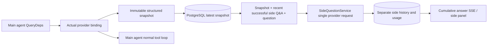

# ARTEX `/btw`

Regular chat, the task MainAgent, and the current task's own workers support independent side questions. Type `/btw question` in the main input to submit; an empty `/btw` or the "Side questions" button opens the history. Desktop uses a resizable side panel; mobile uses a drawer.

Side answers are generated from a snapshot of the agent context taken at submit time, and support streaming, follow-ups, stop and clear. Closing the panel, refreshing the page or dropping the SSE connection never cancels the model request. Stop affects only the current side question; clear cancels the side question and deletes the side history while keeping the main context snapshot.

## Implementation boundaries

Built on Go, norma v0.3.7, Next.js and the existing Markdown / ResizablePanel / Drawer / AlertDialog components; norma's source was not modified and no dependency was added for side questions. The planner, workers inherited from other tasks, and upgrading tool-style subtasks are out of scope.

- `capture.go` marks main-loop requests only in `Options.Deps.CallModel / CallModelSync`. The provider decorator sits inside the concrete model, after the routing pool's outer selection, so it records the model actually chosen; compaction and summary requests do not overwrite the snapshot.
- Snapshots are published at request start, on a complete model reply, and at the run's terminal state. A half-generated reply is never published; tool calls stay paired through norma's `MessagesForAPI`, and tool results enter the snapshot on the next main model request or at the terminal state. An aborted stream keeps the previous valid boundary.
- Snapshots preserve structured messages, the system prompt, tool definitions and generation parameters through a JSON deep copy. Model inference holds no snapshot lock or database transaction.
- `SideQuestionService` calls the concrete provider; it generates a side summary first when needed, and the final answer may be retried once with reduced input only if the first attempt exceeded the context and has not yet produced text/tool calls. It creates no agent session and is not connected to the tool executor, the main transcript, the activity stream or the task graph, nor does it go through the task model-switching chain. The answer keeps tool definitions for compatibility with existing structured tool context; summary requests provide no tools. Newly returned tool calls have no execution path.
- One running request per parent session, at most four per service process, with a 120-second timeout per request. Side questions use a separate cancellation context under the service lifetime.
- Side requests keep a reference to the model config and a non-sensitive identity digest; credentials are taken from the existing config at request time. If the config is deleted, or identity fields such as model, protocol or address change, the main agent must run first to update the snapshot. Tests never change the product's default model.

## Persistence and recovery

`internal/db/schema.sql` creates `side_question_sessions` and `side_question_requests` automatically. The former stores the parent resource, latest snapshot, run number, version and clear version; the latter stores the question, cumulative answer, status, model, snapshot time, usage, event sequence and paging ordinal.

The parent session key is the conversation ID, or task ID + exploration ID + intent ID. Workers do not use reusable execution-slot names.

Snapshots are merged per parent session and flushed every 250 ms; the database compares `(run_id, version)` to stop older versions from overwriting newer ones. The chosen snapshot is saved again before a side question is submitted. Large in-memory snapshots are released after a successful save; on failure the pending version is kept. The cumulative answer is written at most every 250 ms as streaming events arrive, and the terminal state is saved immediately with bounded retries on database errors.

On service start, leftover `running` requests are marked `interrupted`, keeping the partial answer and usage already saved; requests are not replayed automatically. The most recently saved context can be used directly for the next question. An old session without a snapshot requires running the main agent first; context is never rebuilt from UI activity records.

Clear increments the clear version and deletes the requests; conditional updates stop late callbacks from writing back. Physical deletion of the parent resource relies on foreign-key cascades; logical worker deletion removes side data in the same transaction and rejects later late snapshots. Task archiving first blocks new requests, waits for the main flow to stop, then cancels and waits for side data to be saved; the archive format is v3 and stays compatible with v1/v2 archives that have no side tables.

History is stored in full and returned with an ordinal cursor, at most 20 items per page. A model request replays at most the 20 most recent successful Q&A pairs verbatim, further limited by a token budget; older pairs are kept in a separate rolling summary. When the main context exceeds the budget, only the old part of the side copy is summarized, keeping recent structured tool calls and results. Summaries, preparation progress and usage all fall under the side question's concurrency, cancellation and 120-second timeout limits. See [Context budget and open-source references](CONTEXT_BUDGET.md).

## HTTP contract

The following paths serve as `{parent}`, reusing the existing authentication and resource checks:

- `/api/conversations/{id}`
- `/api/tasks/{id}/chat`
- `/api/tasks/{id}/intents/{iid}`

| Request | Response and behavior |
| --- | --- |
| `GET {parent}/side-questions?before={ordinal}` | `items` newest first, a separate `current` run state, `snapshot` metadata and `next_cursor`; a cursor of 0 means the latest page / no next page |
| `POST {parent}/side-questions` | JSON `{ "question": "...", "client_request_id": "UUID" }`; a new request returns 202 with the request object; the same ID and question return the existing object with 200 |
| `DELETE {parent}/side-questions` | Cancel and clear the side Q&A of the current parent session |
| `GET /api/side-questions/{requestID}/events` | `snapshot` SSE events; `id` is an increasing sequence and `data` the full cumulative request object; `cleared` is sent on clear |
| `POST /api/side-questions/{requestID}/cancel` | Explicit cancel; the terminal state can be read from history or SSE |

Questions are limited to 4000 characters. No snapshot, a changed model config, a busy parent session or an idempotency-ID conflict return 409; the global concurrency limit returns 429. Every SSE connection sends the cumulative state first and does not rely on text fragments the client received earlier. The front end merges by request ID + sequence and discards stale callbacks when switching parent session or clearing.

## Verification and references

Regression cases, reproduction commands and UI checks are in the [testing guide](VALIDATION.md).

The standalone request follows [Grok CLI side-question.ts (pinned commit)](https://github.com/superagent-ai/grok-cli/blob/fb97af83f06dca873281d60168430f06c8de6324/src/utils/side-question.ts), and run isolation follows [OpenCode (pinned commit)](https://github.com/anomalyco/opencode/tree/b3f1a96c6dd7adeb28b36dd11add1998fc84d67b). ARTEX context uses norma's structured messages rather than text stitched together from front-end logs.
