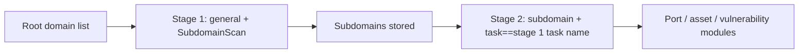

# ScopeSentry MCP guide

For users with an **already deployed ScopeSentry instance**. Connect to the platform through an MCP client; no local source code is needed.

## 1. Preparation

### 1.1 Confirm the service is reachable

- Default web UI: `http://<host>`
- MCP endpoint: `http://<host>/mcp` (behind a reverse proxy or front-end proxy, use the actual `/mcp` address)

### 1.2 Create an API key

1. Log in to the ScopeSentry web UI in a browser
2. Open the **API Key** management page and create a key (or create one through an interface provided by the administrator)
3. Save the returned `ssk_...` string (**it is shown only once**)

### 1.3 Configure the MCP client

Add a server to the MCP client configuration:

```json
{
  "mcpServers": {
    "scopesentry": {
      "url": "http://<your-host>:8082/mcp",
      "headers": {
        "X-API-Key": "ssk_your-key"
      }
    }
  }
}
```

`Authorization: Bearer ssk_your-key` also works.

After configuring, restart the MCP connection or reload the client and confirm that tools such as `list_projects` and `list_assets` appear in the tool list.

## 2. Tool overview

| Tool | Purpose |
| --- | --- |
| `list_projects` | Project tree grouped by tag (with project IDs) |
| `list_projects_data` | Paginated project list, searchable by name |
| `get_project` | Project details |
| `create_project` | Create a project |
| `list_tasks` | Scan task list |
| `get_task` | Task details |
| `list_scan_templates` | Scan template list |
| `get_scan_template` | Template details |
| `list_plugin_modules` | Scan pipeline module names |
| `list_plugins` | Available plugins (with hash and default parameters) |
| `create_scan_template` | Create a scan template |
| `create_scan_task` | Create a scan task |
| `list_assets` | Query every kind of asset (paginated list) |
| `count_assets` | Count assets (`/api/assets/common/total`) |
| `get_asset_detail` | Asset or vulnerability details |
| `add_asset_tag` | Add a tag to an asset |
| `list_nodes` | Scan node list |

The MCP tool descriptions (schemas) are authoritative for each tool's parameters. `list_assets` and `count_assets` share the same search and filter syntax; read the `list_assets` description before querying assets.

When you need to know "how many in total", use `count_assets` (the web UI's pagination-total API) instead of paging through `list_assets` repeatedly.

---

## 3. Common workflows

### 3.1 Query assets by project

When the user or the context **already has a project condition**, add `filter.project` to narrow the scope, so cross-project data does not slow the response down. Without an explicit project, a project filter is not required.

1. Get the target project's **ObjectID** (`id` / `children[].value`) with `list_projects` or `list_projects_data`
2. Pass `filter.project` to `list_assets` (**it must be the ID, never the project's display name**)

```json
{
  "asset_type": "asset",
  "pageIndex": 1,
  "pageSize": 20,
  "search": "domain=^example.com",
  "filter": {
    "project": ["<project ObjectID>"]
  }
}
```

### 3.2 Create a scan task

1. `list_nodes` to get the names of online nodes
2. `list_scan_templates` or `create_scan_template` to get the template **ObjectID**
3. `create_scan_task`: `name` and `node` are required; `template` takes the template ID (not the template name)

**Target source `targetSource` (same as the web UI):**

| targetSource | Meaning | Required parameters |
| --- | --- | --- |
| `general` | Targets entered directly | `target` |
| `project` | Targets read from projects | `project` (array of project ObjectIDs) |
| `asset` | Search the web asset store | `search`; optional `project`, `filter`, `targetNumber` |
| `RootDomain` | Search the root-domain store | `search`; optional `project`, `filter`, `targetNumber` |
| `subdomain` | Search the subdomain store | `search`; optional `project`, `filter`, `targetNumber` |
| `UrlScan` | Search URL scan results | `search`; optional `project`, `filter`, `targetNumber` |
| `*Source` (e.g. `subdomainSource`) | Created from "selected/search" on an asset page | `search` when `targetTp=search`; `targetIds` when `targetTp=select` |

**Example -- scan root domains directly:**

```json
{
  "name": "example-subdomain-collection",
  "node": ["node-1"],
  "template": "<template ObjectID>",
  "targetSource": "general",
  "target": "example.com\nfoo.com",
  "project": ["<project ObjectID>"]
}
```

**Example -- continue from the subdomain store (filtered by the previous task's name):**

```json
{
  "name": "example-ports-and-vulns",
  "node": ["node-1"],
  "template": "<follow-up module template ObjectID>",
  "targetSource": "subdomain",
  "search": "task==\"example-subdomain-collection\"",
  "project": ["<project ObjectID>"]
}
```

### 3.3 Full reconnaissance of root domains (two stages recommended)

When the input is a **root domain** and **full reconnaissance** is wanted, split it into two scans instead of running the whole pipeline at once.

**Why:** distributed tasks are dispatched per **single target**. With a root domain as the target, the node that receives it also runs every follow-up module for the subdomains it discovers, which causes load imbalance, slowness and errors.

**Best practice:**

1. **Stage 1 -- subdomain collection only**
   - `targetSource`: `general`
   - `target`: all root domains (one per line)
   - Template: enable only `SubdomainScan` and `SubdomainSecurity` (subdomain scan + subdomain takeover)
   - Wait for the task to finish with `get_task`

2. **Stage 2 -- follow-up modules**
   - `targetSource`: `subdomain`
   - `search`: `task=="<stage 1 task name>"` (exact task-name match)
   - Optionally narrow with `project`
   - Template: port scan, asset mapping, vulnerability scan, etc. (can omit SubdomainScan)
   - Subdomains are dispatched to nodes as independent targets, which parallelizes far better

Filtering the "Subdomains" asset page in the web UI by task name and using "Create task from subdomains" has the same effect.



### 3.4 Create a scan template

1. `list_plugin_modules` -> list of module names
2. `list_plugins` (filterable by `module`) -> each plugin's `hash` and default `parameter`
3. `create_scan_template`: use `modules` to map "module -> array of plugin hashes"

---

## 4. Asset queries (`list_assets` / `count_assets`)

`count_assets` takes the same `asset_type`, `search` and `filter` as `list_assets` and returns `{ "total": N }`, matching the web UI's `/api/assets/common/total`.

```json
{
  "asset_type": "subdomain",
  "search": "task==\"some-task-name\"",
  "filter": {"project": ["<project ObjectID>"]}
}
```

**Performance tips (for both `list_assets` and `count_assets`):** when there is a project condition, narrow the scope with `filter.project` first; in `search`, prefer `==` exact matches or `^` prefix matches on indexed fields (see [4.3](#43-search-expressions)) and avoid broad `=` fuzzy queries that slow responses down. Without project context a project filter is not required.

The types that support `filter.project` are listed in the [4.4](#44-filter-exact-filtering) table.

### 4.1 Asset types `asset_type`

`asset`, `RootDomain`, `subdomain`, `app`, `mp`, `UrlScan`, `SensitiveResult`, `DirScanResult`, `crawler`, `vulnerability`, `PageMonitoring`, `IPAsset`, `SubdomainTakerResult`

Alias examples: `web`->asset, `vuln`->vulnerability, `ip`->IPAsset, `url`->UrlScan

### 4.2 Parameters

| Parameter | Meaning |
| --- | --- |
| `pageIndex` / `pageSize` | Paging, default 1 / 20 |
| `search` | Search expression (see below) |
| `filter` | Exact-filter JSON (see below) |
| `sort` | Only UrlScan and DirScanResult support sorting by `length` |
| `sid` | SensitiveResult only: sensitive rule name |

`search` and `filter` **can be used together**.

### 4.3 search expressions

A custom DSL (**not SQL**):

| Operator | Meaning | Index | Example |
| --- | --- | --- | --- |
| `=` | Fuzzy match (regex) | Not indexed | `domain=example` |
| `==` | Exact match | **Indexed** | `port==443` |
| `!=` | Exclude | -- | `port!="80"` |
| `&&` | And | -- | `domain==example.com && port==443` |
| `\|\|` | Or | -- | `title=admin \|\| body=login` |

**Indexes and operators:** fields such as `domain`, `ip`, `port` and `title` are indexed, but only **`==` exact matches** or **prefix matches whose value starts with `^`** (e.g. `domain=^example.com`) use the index; **`=` becomes a regex fuzzy match and cannot use the index**, which gets slow on large data sets.

**search fields common to every type:** `tag`, `task` (task name), `rootDomain`

**project cannot go in search** (it is ignored, or errors when combined with `&&`). Filter projects with `filter.project`.

**Common search fields per type:**

| asset_type | Fields |
| --- | --- |
| asset | domain, ip, port, service, app, title, statuscode, icon, banner, type, body, header |
| RootDomain | domain, icp, company |
| subdomain | domain, ip, type, value |
| app | name, icp, company, category, description, url, apk |
| mp | name, icp, company, category, description, url |
| UrlScan | url, input, source, resultId, type |
| SensitiveResult | url, sname, body, info, md5 |
| DirScanResult | url, statuscode, redirect, length |
| vulnerability | url, vulname, matched, request, response, level |
| crawler | url, method, body, resultId |
| PageMonitoring | url, hash, diff, response |
| IPAsset | ip, domain, port, service, webServer, app |
| SubdomainTakerResult | domain, value, type, response |

**search examples:**

- `domain==www.example.com && port==443` (exact, indexed)
- `domain=^example.com` (prefix, indexed)
- `ip==192.168.1.1`
- `task=="some-task-name"`
- `level==high` (vulnerability)
- `statuscode==200` (DirScanResult)

Use `=` only when you really need a fuzzy "contains" match, e.g. `title=admin` (not indexed; combine with project or other conditions to narrow the scope).

### 4.4 filter exact filtering

A JSON object: several values for the same key are **OR**, different keys are **AND**.

**Prefer `project` when there is a project condition:** if the user or context names a project and the asset_type supports `project`, include it to narrow the scope; it is not required without project information.

| filter key | Meaning | Values |
| --- | --- | --- |
| `project` | Owning project | **ObjectID**, from `list_projects` / `list_projects_data` |
| `task` | Source task | **Task name**, the `name` from `list_tasks` |
| `port` | Port | e.g. `"443"` |
| `service` | Service/protocol | e.g. `"https"` |
| `app` | App fingerprint | e.g. `"Nginx"` |
| `icon` | Icon hash | |
| `statuscode` | HTTP status code | Mainly for asset |
| `status` | Status | HTTP code for UrlScan/DirScan; handling status for vulnerabilities/sensitive results |
| `level` | Vulnerability level | critical / high / medium / low / info |
| `type` | Type | e.g. subdomain record types A, CNAME |
| `color` | Sensitive rule color | SensitiveResult |
| `sname` | Sensitive rule name | SensitiveResult |
| `tags` | Tags | |

**filter keys available per type:**

| asset_type | filter keys |
| --- | --- |
| asset | project, port, service, app, icon, statuscode, type, task, tags |
| RootDomain | project, tags |
| subdomain | project, type, task, tags |
| app / mp | project, tags |
| UrlScan | status, tags |
| DirScanResult | status, tags |
| SensitiveResult | status, color, sname, tags |
| crawler | project, task, tags |
| vulnerability | project, level, status, task, tags |
| PageMonitoring / SubdomainTakerResult | tags |
| IPAsset | project, port, service, app |

**filter example:**

```json
{"project": ["<project ObjectID>"], "port": ["443"]}
```

**Combined query example:**

```json
{
  "asset_type": "asset",
  "search": "domain=^baidu && port==443",
  "filter": {"project": ["<project ObjectID>"]},
  "pageIndex": 1,
  "pageSize": 10
}
```

**Notes:**

- With a project condition, include `filter.project` (where supported); without project context it is not required
- Never put a project's display name in `filter.project`
- Use `==` for known values and `^` for prefixes; avoid overusing `=` fuzzy matches on large tables
- For UrlScan HTTP status use `filter.status`; for DirScanResult you can use `statuscode==200` in search
- For SensitiveResult by rule name: `sname=<rule name>` in `search`, or `filter.sname`

### 4.5 Sorting with sort

Only **UrlScan** and **DirScanResult** support it:

```json
{"length": "ascending"}
```

Other types ignore `sort` and are sorted by time by default.

---

## 5. Scan template module names

`TargetHandler`, `SubdomainScan`, `SubdomainSecurity`, `PortScanPreparation`, `PortScan`, `PortFingerprint`, `AssetMapping`, `AssetHandle`, `URLScan`, `WebCrawler`, `URLSecurity`, `DirScan`, `VulnerabilityScan`, `PassiveScan`

---

## 6. Troubleshooting

| Symptom | Fix |
| --- | --- |
| MCP shows no tools | Check the URL, the API key and that ScopeSentry is running |
| 401 / 403 | Create or switch to a new API key |
| Assets not found | Make sure `filter.project` is an ObjectID; never put project in search |
| Template/task creation fails | `template` must be a template ObjectID; `node` takes online node names |
| Queries slow or stuck | Add `filter.project` when there is a project; in search use `==` or a `^` prefix on indexed fields and avoid `=`; lower `pageSize` |
